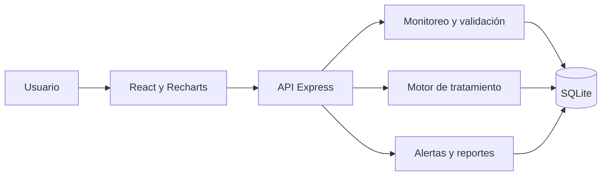

# Arquitectura

React presenta formularios, historial, dashboard y reportes. Vite compila el cliente y en desarrollo se integra como middleware de Express. El navegador consulta el API por HTTP en el mismo origen.

La API registra la entrada original y crea una sesión con tecnología, duración, reloj y aire exterior. Cada consulta del estado materializa los minutos pendientes y actualiza la sesión en una transacción. El navegador consulta cada medio segundo mientras alguna sesión esté activa. El último punto persistido es la salida de una sesión detenida o completada. El dashboard trabaja con las respuestas del API y evita mezclar ppm con µg/m³ en un eje.

